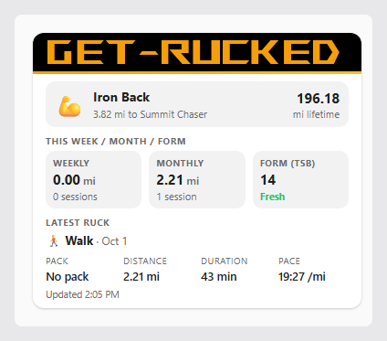
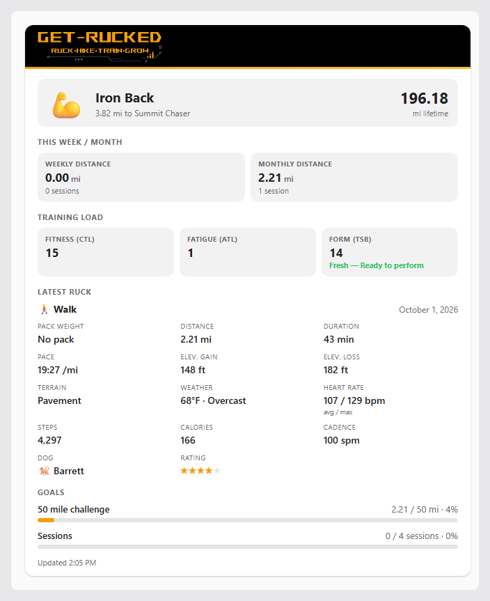
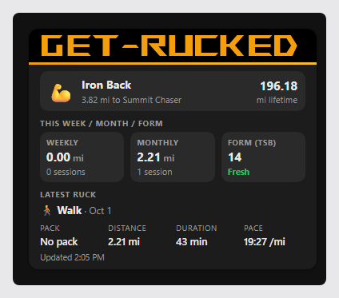
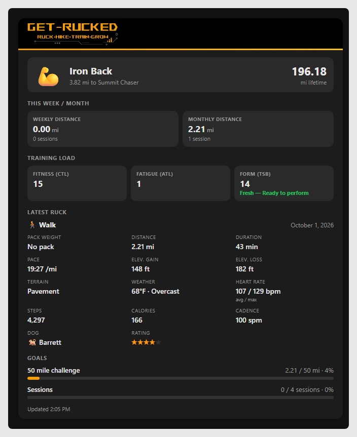

# Get-Rucked for Home Assistant

A [HACS](https://hacs.xyz/) custom integration that pulls your [Get-Rucked](https://www.get-rucked.com/) stats — latest ruck, weekly/monthly distance, goals, training load (CTL/ATL/TSB), and rank — into Home Assistant. Requires an active **Get-Rucked Premium** subscription.

## Install

How you add this repository depends on your Home Assistant version:

### Home Assistant 2026.10 and older (HACS)

1. In HACS, open the **⋮** menu (top right) → **Custom repositories** → paste `EvergreenOdyssey/ha-getrucked` → category **Integration** → **Add**.
2. Install **Get-Rucked** from HACS, then restart Home Assistant.

### Home Assistant 2026.11 and newer (Marketplace)

Starting with 2026.11, the standalone HACS integration is replaced by **Marketplace**, built into Home Assistant under **Settings → Marketplace**. It reads the same catalog as HACS and uses the same `hacs.json`, so this repo doesn't need separate support for it — but it does apply stricter checks before installing a repo, and (per the official docs) expects the repo to have at least one published **release**. This repo now has pre-releases (see Status below), so that part's covered — the exact add-a-custom-repo flow for Marketplace itself still isn't documented publicly as of this writing, so test this one yourself rather than taking this README's word for it.

### Then, either way

1. **Settings → Devices & Services → Add Integration → Get-Rucked**.
2. In the Get-Rucked app: **Profile → Home Assistant → Generate New Token**, then paste the raw token (no `Bearer` prefix — the integration adds that itself) into the setup dialog.

That's it — a "Get-Rucked" device appears with all the sensors below, polling every 15 minutes by default (configurable, minimum 15 minutes, via the integration's **Configure** button).

## Entities

- Latest Ruck Distance (+ date, type, elevation loss, terrain, cadence, rating, weather condition, max heart rate, stop count, dog name as attributes)
- Latest Ruck Duration, Pace, Pack Weight, Elevation Gain, Calories, Steps, Weather Temp, Heart Rate (Avg) — promoted to their own sensors (so they get real history graphs) rather than staying as attributes
- Weekly Distance / Monthly Distance (+ session count, minutes, elevation, calories, training load as attributes)
- Fitness (CTL), Fatigue (ATL), Form (TSB) (+ a plain-language label)
- Rank (+ total miles and icon as attributes)
- Distance To Next Rank
- One **Goal: `<title>`** sensor per active goal (percent complete, with the goal's type/target/period as attributes) — these are created and removed automatically as you add or delete goals in the app.

## The dashboard card

A bundled `custom:getrucked-card` ships with the integration — no separate install, no manual dashboard resource. It's served and registered automatically on setup.

| Compact | Detailed |
|---|---|
|  |  |
|  |  |

*(Renders of the approved design — see Status below for where live-instance verification stands.)*

**Adding the card:**

1. Edit a dashboard → **Add Card** → search for **Get-Rucked** (or add it as `type: custom:getrucked-card` in YAML mode).
2. Pick your Get-Rucked device, a **Compact** or **Detailed** layout, and which metrics/Latest Ruck fields to show — each list has checkboxes and ▲▼ buttons to reorder. Compact defaults to rank, week/month, Form (TSB), and a condensed Latest Ruck; Training Load and Goals are off by default in compact (toggle them on if you want a taller card).
3. Tapping any metric opens its normal Home Assistant more-info dialog (history graph), the same as tapping an entity row anywhere else in HA.

The card follows your dashboard's light/dark theme automatically — only the "Get-Rucked" banner strip stays a fixed near-black, matching the brand everywhere else in the product.

## Errors and re-auth

- An invalid or revoked token triggers Home Assistant's normal re-authentication flow — paste a fresh token from the app and you're back up.
- If your Premium subscription lapses, entities go unavailable and a repair issue explains why (Settings → Repairs). Nothing to do — it clears itself and entities come back automatically once Premium is active again, with the same token.
- Revoking a token in the app and generating a new one for the **same account** does not create a second device — identity is tied to the account, not the token.

## Manual YAML setup

Don't want to use HACS? A YAML-based setup (no custom integration) is also documented at [get-rucked.com/home-assistant](https://www.get-rucked.com/home-assistant).

## Status

Pre-release (currently beta.5, after beta.1–beta.4) — not yet tagged as the full `v0.1.0`. The card above has been through a design-review mockup pass (the screenshots are that approved design) but **not yet exercised on a real Home Assistant instance** — things like the exact `window.customCards` picker behavior, the storage-mode Lovelace resource auto-create/update, and the "Premium required" detection via `hass.issues` are implemented against the documented APIs but still need a live confirm. `v0.1.0` won't be tagged until that happens.

Every pre-release's `manifest.json` `version` is kept in sync with its GitHub tag (`v0.1.0-beta.N` ↔ `0.1.0bN`, PEP 440 style, since that's what Home Assistant's own version comparator expects) specifically so the integration's page in Settings shows which beta you actually have installed, instead of every beta showing the same bare `0.1.0`.

Local brand icon (`custom_components/getrucked/brand/`) is already in place, per Home Assistant 2026.3+'s local-brand-image support — no `home-assistant/brands` PR needed, and it displays correctly on the integration's own page in Home Assistant. **HACS's own repository-browser listing will still show "icon not available"** for this repo — that's a currently-open upstream HACS bug ([hacs/integration#5171](https://github.com/hacs/integration/issues/5171), [#5223](https://github.com/hacs/integration/issues/5223)): HACS's downloads panel pulls icons from a central CDN populated from the `home-assistant/brands` repo, which stopped accepting custom-integration icon submissions once local brand images were introduced — so there's currently no way for a custom (non-default-catalog) repo to supply HACS's own listing icon. A fix has been proposed upstream ([hacs/frontend#945](https://github.com/hacs/frontend/pull/945)) but isn't confirmed merged as of this writing. Nothing to do here until that lands.

## Development

Python (the integration):
```
pip install -r requirements_test.txt
pytest
```

The dashboard card (TypeScript + [Lit](https://lit.dev/), bundled with [esbuild](https://esbuild.github.io/)):
```
npm install
npm test          # vitest, pure-logic unit tests (entity matching, formatting)
npm run build     # rebuilds custom_components/getrucked/www/getrucked-card.js
```

The built `getrucked-card.js` is committed (that's the file HA actually serves) — CI fails if it doesn't match a fresh `npm run build` of the current source, so a source change without a rebuild can't slip through.

CI runs [hassfest](https://www.home-assistant.io/docs/creating_integration_manifest/), [HACS validation](https://hacs.xyz/docs/publish/integration/), the Python test suite, and the card's typecheck/tests/build on every push and PR.

## License

MIT — see [LICENSE](LICENSE).
